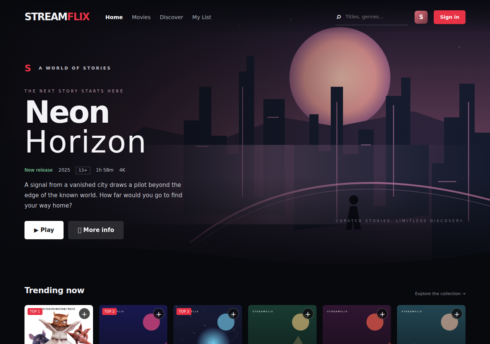

# StreamFlix

A hands-on microservices and Kubernetes learning project with a Netflix-inspired interface. Work through each component, inspect its configuration and logs, and understand failures before fixing them.



## Start here

- [Architecture and service guide (Word)](docs/v2/StreamFlix-v2-Architecture-and-Deployment.docx)
- [Kind and observability setup (Word)](docs/v2/Kind-Cluster-and-Observability-Setup.docx)
- [Deployment and release guide](docs/v2/DEPLOYMENT.md)
- [Validation record and limitations](docs/v2/VALIDATION.md)
- [Architecture diagram](docs/v2/architecture.png)

The learning platform was installed on the three-node `streamflix-v2` kind cluster. The application release has not been deployed. GitHub Actions image scans identified vulnerabilities in the Node base image's bundled npm tooling; the local Dockerfile fix awaits verification. Argo CD is a later learning phase.

## Repository layout

```text
.github/workflows/          Active validation/publication and deployment workflows
.github/dependabot.yml      Weekly dependency update configuration
app/                       Service source, migrations and Dockerfiles
app/shared/                Shared Node runtime, security, tracing and migrations
tests/                     Node, Python and browser checks
gitops/charts/streamflix/   Consolidated application Helm chart
gitops/environments/        Learning/production values and promoted image references
gitops/platform/            Networking, PKI, monitoring and log/trace configurations
infra/kind/kind-v2.yaml     Current kind cluster configuration
scripts/v2/                Platform, deployment, validation and documentation helpers
docs/v2/                   Current setup and architecture documentation
```

The `v2` path and resource names are retained because workflows, scripts and the existing cluster use them. This repository contains the current setup only.

## Delivery flow

```text
You edit, commit and push source
    → GitHub-hosted runners validate the code
    → twelve service images are built and pushed to Docker Hub
    → Trivy scans each image
    → successful scans produce an image promotion pull request
    → you review and merge the exact image digests
    → you manually trigger deployment on a configured self-hosted runner
    → Helm deploys the application into kind
```

[ci.yml](.github/workflows/ci.yml) validates pull requests and publishes images for qualifying `main` pushes or manual runs on `main`. [deploy.yml](.github/workflows/deploy.yml) runs only on manual request. Required PR reviews and deployment approvals must be configured in GitHub repository/environment settings; they are not automatically enforced by the workflow names.

Docker Hub credentials belong in GitHub Actions secrets. Cluster credentials and application secrets must not be committed. The learning bootstrap generates application secrets directly into Kubernetes; the production profile expects an external secret-manager integration.

## Components to learn

- Application Deployments, ReplicaSets, Pods, Services, DNS and Ingress.
- ConfigMaps, Secrets, service accounts, RBAC, certificates and CA trust.
- StatefulSets, PVCs and storage for Postgres, Redis, Elasticsearch and Kafka.
- Probes, resource requests/limits, topology spreading, HPA, VPA and disruption budgets.
- NetworkPolicy, Pod Security, quotas, migrations and scheduled Jobs.
- Prometheus metrics, Grafana dashboards, Loki/Alloy logs, Tempo traces and alert rules.
- GitHub Actions, Docker image publication, vulnerability gates, release promotion and later Argo CD.

The learning profile has single-instance datastores and node-local storage. Billing and video encoding are sandbox exercises. Production acceptance requires resilient infrastructure, provider integrations, staging validation and recovery testing; the project is not a verified production deployment.
